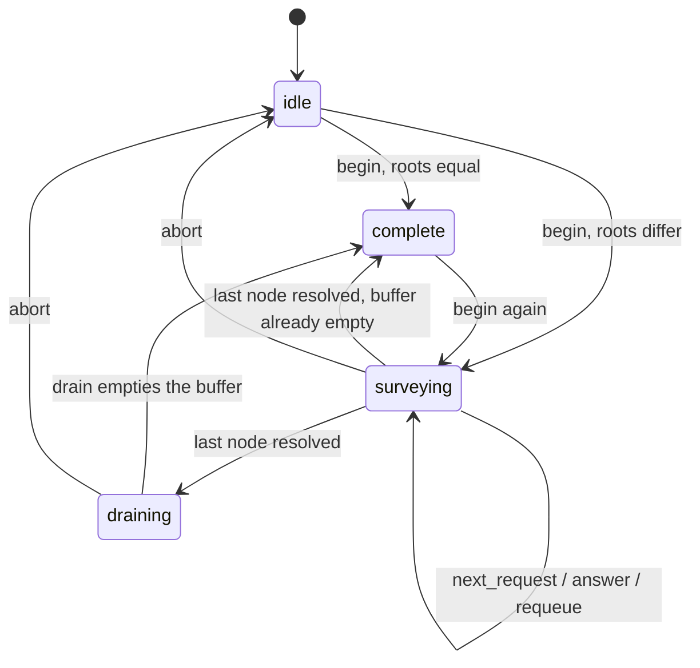
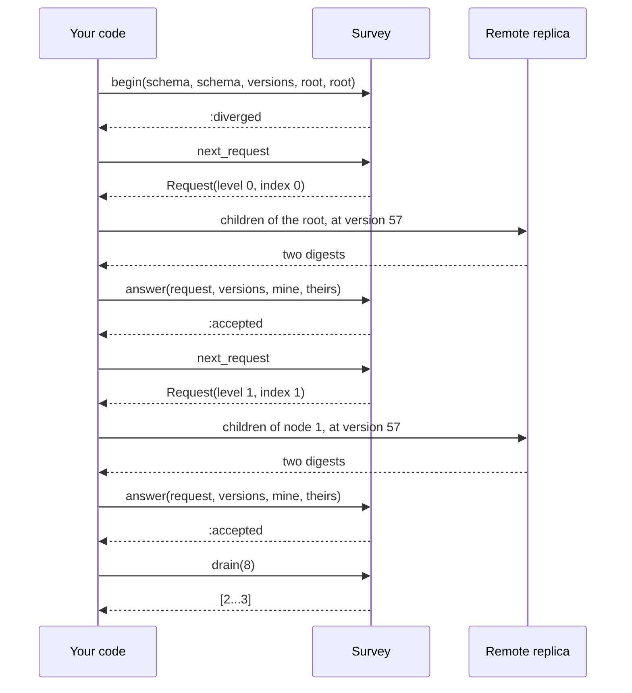

# MerkleMachines

> Two replicas disagree. Find out where before you ship the whole dataset. 🧭

A divergence survey for Ruby. You have two digest trees of the same shape, one per replica, and their roots differ. The survey tells you which nodes to fetch child digests for, compares what you bring back, and hands you the ranges of leaves that actually differ. It holds a fixed number of nodes and a fixed number of ranges, so a badly diverged pair slows the survey down instead of growing it.

## Quick Start

```bash
gem 'merkle_machines'
```

```ruby
schema   = MerkleMachines::Schema.new(fanout: 16, depth: 3, partitioning: 1, digest: 1)
versions = MerkleMachines::Versions.new(local: mine.version, remote: theirs.version)
survey   = MerkleMachines::Survey.new

case survey.begin(schema, theirs.schema, versions, mine.root, theirs.root)
when :identical then return
when :diverged  then nil
else raise 'trees are not comparable'
end

until survey.phase == :complete
  if (request = survey.next_request)
    survey.answer(request, versions,
                  mine.children(request.node.level, request.node.index),
                  theirs.children(request.node.level, request.node.index))
  end
  survey.drain(MerkleMachines::OUTPUT_CAPACITY).each { |leaves| repair(leaves) }
end
```

One survey, a handful of methods. Digests are Strings you computed. Everything else is an Integer.

## A Message to the Resistance

So your two replicas drifted. A write landed on one during a partition, or a repair job died halfway, and now the row counts match and the checksums don't.

You know the textbook answer. "Use a Merkle tree." Hash the leaves, hash the hashes, compare the roots, walk down where they differ. Then you write the walk. It recurses, so a pair of replicas that disagree everywhere allocates a frontier the size of the tree. It talks to the other node from inside the recursion, so a dropped connection loses your place. Someone compacts the remote tree halfway through and you spend an afternoon repairing leaves that were never different. And one day a replica is rebuilt with sixteen children per node instead of eight, the walk compares child 3 with child 3 anyway, and every leaf looks wrong.

The walk is a small state machine: which nodes still need their children fetched, which requests are out, which leaf ranges are ready. With a refusal for trees that can't be compared, and a refusal for a tree that moved. That machine is this gem.

## Chapter 1: Stardate 2026.316, the AMS Merkle

> **AMS Merkle**, NCC-4224, *Merkle*-class survey cutter.
> Two charts of the same sector. Mark where they disagree, and nothing else.

The cutter doesn't draw charts and doesn't correct them. Two ships surveyed the same sector and came back with two charts. The cutter lays them side by side, quadrant by quadrant, and asks for a closer look only where the summaries differ. It carries a small plotting table, so it asks for a few quadrants at a time and files its findings as it goes.

On a bridge somewhere, a cadet volunteers:

```ruby
def diff(node)
  return [node.leaf] if node.leaf?
  node.children.zip(remote.children(node)).flat_map { |a, b| a.digest == b.digest ? [] : diff(a) }
end
```

"That," says the cutter's navigator, "is a network call inside a recursion inside a hope that nobody edits the other chart."

## The Flight Plan

A survey moves through four phases:



And one exchange, over a tree of four leaves where only leaf 2 differs:



## How the Survey Works

### Schema

```ruby
schema = MerkleMachines::Schema.new(fanout: 2, depth: 2, partitioning: 1, digest: 1)
```

`fanout` is children per node, from 2 to 64. `depth` is the number of levels below the root, so this tree has four leaves. `partitioning` and `digest` are numbers you choose to name how keys map to leaves and how digests are computed. The survey never interprets them. It only checks that both sides say the same thing.

A shape that is not a tree is not a `Schema`. A fanout outside 2..64, or more leaves than fit in 64 bits, raises `RangeError` from `Schema.new`:

```ruby
MerkleMachines::Schema.new(fanout: 1, depth: 2, partitioning: 1, digest: 1)    # RangeError
MerkleMachines::Schema.new(fanout: 2, depth: 64, partitioning: 1, digest: 1)   # RangeError
```

### Begin

```ruby
versions = MerkleMachines::Versions.new(local: 40, remote: 57)
survey   = MerkleMachines::Survey.new

survey.begin(schema, schema, versions, 'root-a', 'root-b')   # => :diverged
survey.phase                                                  # => :surveying
```

A schema answers the questions the core's does:

```ruby
schema.leaves                                       # => 4
schema.width(1)                                     # => 2 nodes at level 1
schema.span(MerkleMachines::Node.new(1, 1))         # => 2...4, the leaves below that node
schema.span(MerkleMachines::Node.new(3, 0))         # => nil, not a node of this tree
schema.span(MerkleMachines::Node::ROOT)             # => 0...4
schema.compatible(schema.with(fanout: 4))           # => :fanout_mismatch
schema.compatible(schema)                           # => :compatible
survey.schema                                       # => the open session's Schema, nil when idle
survey.versions                                     # => the Versions it pinned, nil when idle
```

Equal roots answer `:identical` and the survey is `:complete` on the spot. Trees that can't be compared are refused by name, and no session opens:

```ruby
other = schema.with(fanout: 4)
MerkleMachines::Survey.new.begin(schema, other, versions, 'a', 'b')   # => :fanout_mismatch
```

The others are `:depth_mismatch`, `:partitioning_mismatch` and `:digest_mismatch`. A survey that is still working answers `:busy`.

### Request

```ruby
request = survey.next_request
# => #<data MerkleMachines::Request session=1, node=#<data MerkleMachines::Node level=0, index=0>>
```

A request names one node: `request.node` is a `Node` with a `level` (0 is the root) and an `index` within that level. Fetch that node's child digests from both trees, in child order. `nil` means nothing is queued right now: answers are still out, the range buffer is full, or the survey is finished. Call it as many times as you want requests in the air.

### Answer

```ruby
survey.answer(request, versions, %w[left same], %w[left changed])   # => :accepted

request = survey.next_request
# => #<data MerkleMachines::Request session=1, node=#<data MerkleMachines::Node level=1, index=1>>
survey.answer(request, versions, %w[x y], %w[z y])                  # => :accepted
```

The survey compares the two lists position by position and queues the children that differ. Children that match are never visited again. An answer it can't use is refused and changes nothing:

```ruby
survey = MerkleMachines::Survey.new
survey.begin(schema, schema, versions, 'root-a', 'root-b')
request = survey.next_request

survey.answer(request, versions.with(remote: 58), %w[a b], %w[a c])   # => :version_changed
survey.answer(request, versions, %w[a], %w[a c])                      # => :arity
survey.answer(request, versions, %w[a b], %w[a b])                    # => :inconsistent
elsewhere = request.with(node: request.node.with(level: 1))
survey.answer(elsewhere, versions, %w[a b], %w[a c])                  # => :unexpected
```

`:inconsistent` means the parents differed and no child does, so the digests didn't come from one tree. `:stale` is the answer to a request from a session that was aborted or replaced.

### Drain

```ruby
survey.answer(request, versions, %w[a b], %w[a c])    # => :accepted
survey.answer(survey.next_request, versions, %w[x y], %w[z y])

survey.phase         # => :draining
survey.drain(8)      # => [2...3]
survey.phase         # => :complete
survey.pop_range     # => nil, nothing buffered
```

Ranges are leaf indices, end excluded. `drain(limit)` hands back at most `limit` of them, sorted, with neighbours joined, and keeps the rest buffered; `MerkleMachines::OUTPUT_CAPACITY` takes everything there can be. `pop_range` takes just the lowest one, or `nil`. Two calls can return ranges that touch each other, because the second one was found after you took the first.

### Requeue

A request you sent and never heard back about goes back in the queue:

```ruby
survey = MerkleMachines::Survey.new
survey.begin(schema, schema, versions, 'root-a', 'root-b')
request = survey.next_request

survey.requeue(request)   # => :requeued
survey.requeue(request)   # => :unexpected, it is not in flight any more
survey.next_request == request   # => true
survey.requeue_all        # => 1, for when the whole connection dropped
```

`requeue` answers `:stale` for a request from a session that was aborted or replaced, and `:unexpected` for a node that is not in flight. Neither changes anything.

### Abort

```ruby
survey.abort   # => :aborted
survey.phase   # => :idle
survey.abort   # => :already_idle, there was no session to drop and nothing changed
```

Abort when a tree moved under you. The buffered ranges are discarded, every outstanding request becomes `:stale`, and the next `begin` pins the new versions.

### What each call answers

| Call | Honoured | Refused, nothing changed |
| --- | --- | --- |
| `begin` | `:identical`, `:diverged` | `:fanout_mismatch`, `:depth_mismatch`, `:partitioning_mismatch`, `:digest_mismatch`, `:busy`, `:undersized`, `:exhausted` |
| `answer` | `:accepted` | `:stale`, `:unexpected`, `:version_changed`, `:arity`, `:inconsistent` |
| `requeue` | `:requeued` | `:stale`, `:unexpected` |
| `requeue_all` | the number requeued | never refuses |
| `drain(limit)` | an Array of Ranges, empty when none is buffered | never refuses |
| `pop_range` | a Range, or `nil` when none is buffered | never refuses |
| `next_request` | a `Request`, or `nil` when nothing is queued | never refuses |
| `abort` | `:aborted`, or `:already_idle` when no session was open (an idempotent repeat) | never refuses |
| `schema`, `versions` | the open session's `Schema` / `Versions`, or `nil` when the survey is idle | a query, never refuses |

`:undersized` means the tree is deeper than `PENDING_CAPACITY`, and `:exhausted` means the session counter ran out after 2**64-1 sessions. Every refusal has its own symbol; there is no catch-all. The core's `Refusal::Schema(Mismatch)` answers with the mismatch's symbol, the same four `Schema#compatible` uses.

### Capacity

```ruby
MerkleMachines::PENDING_CAPACITY   # => 64
MerkleMachines::OUTPUT_CAPACITY    # => 64
MerkleMachines::MAX_FANOUT         # => 64

survey.pending     # nodes held: queued, in flight, or answered and waiting for room
survey.in_flight   # requests out
survey.buffered    # ranges waiting for drain
```

A survey holds at most 64 nodes and 64 ranges. When the range buffer is full, answered nodes wait and `next_request` returns `nil` until you call `drain` or `pop_range`. Nothing is dropped and no answer is refused for lack of room.

## The Rules of the Navigator

- **Digests are Strings.** Use binary strings (`.b`). They are compared byte for byte, and two strings with the same bytes in incompatible encodings are different digests. Anything else raises `TypeError`.
- **Numbers are Integers** in `0..2**64-1`. `fanout`, `depth`, and `level` stop at 255. Floats, nil, and strings raise `TypeError`. Out of range raises `RangeError`.
- **Schemas, versions, nodes, and requests are value objects.** `Schema`, `Versions`, `Node` and `Request` are frozen `Data` values with the fields of the core types they are named after. An Array in their place raises `TypeError`.
- **Refusals don't raise.** Every refusal is a Symbol, and a refused call changes nothing. Only malformed input raises.
- **One version of each tree per session.** Every answer names the versions its digests were read at. Different versions are refused.
- **Frozen means frozen.** `freeze` the survey and every method that would change it raises `FrozenError`.

## What You Think You're Doing vs Reality

### You Think: "Merkle trees find the difference with the fewest messages."
### Reality: They find it without sending everything.

The survey visits the nodes whose digests differ and skips the rest. That is all it promises. It makes no claim about minimal exchange or round count: two replicas that disagree on every leaf cost you every internal node, which is more than shipping the leaves outright. How many requests you keep in the air, how you batch them, and when you give up and copy the lot are your decisions.

### You Think: "Equal digests, equal data."
### Reality: Equal digests, and you chose the hash.

The survey trusts a matching digest and never looks below it. A collision in your digest hides a difference, and the survey can't know.

## What's Yours

This is an early release and the API will change. It is a policy core, not a sync runtime.

You build the trees and compute every digest. The survey does no hashing. You talk to the other replica, in whatever protocol and batch size you like, and you decide when a request is lost. You keep each tree readable at the version you pinned for as long as the session runs, or you abort and start over. You pick the `partitioning` and `digest` numbers and make sure equal numbers really mean equal layouts. You decide what a differing leaf range means: the survey locates divergence, it doesn't merge, repair, or pick a winner. And the survey lives in your process, so a restart means a new `begin`.

## License

MIT License. See [LICENSE.txt](LICENSE.txt) for details.

**Remember: the root told you they differ. The survey tells you where. Fixing it is still your job.**
